<p align="center"></p>

# living-canvas

**A Claude skill that turns a GitHub repo, URL, doc, topic, or a single sentence into a small piece of animated art.** It is made for the top of a README: one self-contained animated SVG, no JavaScript, no external fonts or images, usually under 10 KB.

The idea is simple: your repo already has a story. living-canvas reads it, finds the one transformation at its heart, and turns that into motion that says something true about the project, instead of a generic gradient blob.

## Examples

Both of these were generated by the skill from nothing but the repo URL.

### [DEV·TV](https://github.com/shouvik12/devtv): the developer internet, broadcast

<p align="center"></p>

A CRT set that tunes through all seven channels, with a burst of real noise static on every change, a scrolling ticker and a blinking LIVE light. It matches the app itself.

### [Trooper](https://github.com/shouvik12/trooper): keeps agents alive

<p align="center"></p>

A tactical radar where a request carries its compacted context (ANCHOR, SITREP, TAIL) through a fallback chain: one cloud provider is rate-limited, the next is down, and the local model takes it with the context intact.

## How it works

1. **Understand the subject.** Reads the README, file tree and tagline, and boils it down to one core idea, a mood, a few key visual elements and a tagline of eight words or fewer.
2. **Pick a metaphor that fits.** Pipelines become things flowing into a core; AI and networks become particles and orbits; games become terrain racing toward a horizon; CLIs become terminal lines resolving into a result.
3. **Choose the format.** For a README: an animated SVG (SMIL + CSS keyframes) at around 900×300. For anything else: a fullscreen interactive `<canvas>` page.
4. **Craft it.** A dark, rich background, two or three accent colors taken from the subject, layered depth, a seamless loop, readable motion and full `prefers-reduced-motion` support.

## Install

**Claude (claude.ai and the desktop app):** download this repo as a ZIP and upload it under **Settings → Capabilities → Skills**. Then ask:

```
/living-canvas https://github.com/you/your-repo, for the README
```

**Claude Code:** clone it into your skills folder.

```bash
git clone https://github.com/shouvik12/living-canvas ~/.claude/skills/living-canvas
```

## Using the result

Commit the SVG to your repo and reference it at the top of your README:

```bash
mkdir -p assets && mv your-canvas.svg assets/
git add assets/your-canvas.svg && git commit -m "Add animated README banner" && git push
```

```markdown
<p align="center"></p>
```

GitHub renders the animation directly: SMIL and CSS keyframes both work inside an ``, and no scripts are needed.

## Ground rules the skill follows

- No copyrighted characters, other companies' logos or real people.
- No JavaScript and no external assets in README output, so it renders anywhere GitHub does.
- Motion stays smooth and readable, without harsh flicker, and stops for viewers who prefer reduced motion.

## On DEV·TV

living-canvas is tagged so it can appear on the **AGENT SKILLS** channel of [DEV·TV](https://shouvik12.github.io/devtv/), a retro TV for the developer internet.

## License

MIT, see [LICENSE](LICENSE).
